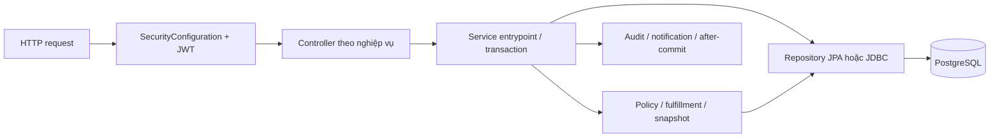

# Bản đồ nghiệp vụ

Tra API ở API_INDEX → mở facade → đọc component/repository ngay trong cùng package. Entity/enum/exception dùng chung có thể nằm ở gốc domain. Không tạo bản service riêng theo role.

| Package | Class |
|---|---|
| `com.scms.backend` | `ScmsBackendApplication` |
| `com.scms.backend.account` | `Account`, `AccountRepository`, `AccountRole`, `AccountStatus`, `MemberProfile`, `MemberProfileRepository` |
| `com.scms.backend.audit` | `AuditEvent`, `AuditEventRepository`, `AuditHistoryController`, `AuditHistoryPageResponse`, `AuditHistoryResponse`, `AuditHistoryService`, `AuditHistorySpecifications`, `AuditHistoryValidationException` |
| `com.scms.backend.auth` | `AccountIdentifierAvailability`, `ActiveAccountJwtValidator`, `AuthProperties`, `AuthResponse`, `AuthSession`, `AuthenticationController`, `AuthenticationService`, `ChangePasswordRequest`, `ChangePasswordValidationException`, `CurrentPasswordIncorrectException`, `DuplicateAccountException`, `InvalidAuthenticatedAccountException`, `InvalidCredentialsException`, `InvalidRefreshTokenException`, `JwtTokenService`, `LoginRequest`, `NewPasswordSameAsCurrentException`, `PasswordConstraints`, `RefreshToken`, `RefreshTokenCookieService`, `RefreshTokenRepository`, `RefreshTokenService`, `RegistrationController`, `RegistrationOutcome`, `RegistrationRequest`, `RegistrationResponse`, `RegistrationService`, `RegistrationValidationException` |
| `com.scms.backend.centervisit` | `CenterVisit`, `CenterVisitController`, `CenterVisitException`, `CenterVisitPageResponse`, `CenterVisitRepository`, `CenterVisitRequest`, `CenterVisitResponse`, `CenterVisitService`, `CenterVisitSource`, `CheckoutSource` |
| `com.scms.backend.common.error` | `AccountProblemResponses`, `AuthenticationProblemResponses`, `CourseProblemResponses`, `GlobalExceptionHandler`, `MembershipProblemResponses`, `OperationsProblemResponses`, `ProblemDetails`, `SchedulingProblemResponses`, `SecurityProblemDetailHandler`, `TrainingProblemResponses` |
| `com.scms.backend.common.validation` | `PersonNameRules` |
| `com.scms.backend.config` | `OpenApiConfiguration`, `SecurityConfiguration`, `TimeConfiguration` |
| `com.scms.backend.course` | `Course`, `CourseAttendanceException`, `CourseAttendanceStatus`, `CourseException`, `CourseFieldLimits`, `CourseOrderException`, `CourseRefundException`, `CourseRefundSource`, `CourseRefundStatus`, `CourseRun`, `CourseRunStatus`, `CourseSession`, `CourseSessionStatus`, `CourseStatus`, `CourseTransferException`, `CourseWaitlistException`, `CourseWithdrawalCause`, `CourseWithdrawalEligibilityReason`, `CourseWithdrawalException`, `RegistrationStatus`, `VersionRequest` |
| `com.scms.backend.course.catalog` | `CatalogCoursePageResponse`, `CatalogCourseResponse`, `CatalogCourseRunDetailResponse`, `CatalogCourseRunPageResponse`, `CatalogCourseRunResponse`, `CatalogCourseSessionResponse`, `CourseCatalogController`, `CourseCatalogService`, `CourseImageController`, `CourseImageResources` |
| `com.scms.backend.course.enrollment` | `CourseEnrollmentApiModels`, `CourseEnrollmentController`, `CourseEnrollmentRepository`, `CourseEnrollmentResponse`, `CourseEnrollmentService`, `CourseReceptionActionsController`, `ReceptionCourseEnrollmentRepository`, `ReceptionCourseEnrollmentService` |
| `com.scms.backend.course.management` | `CourseAdministration`, `CourseApprovalController`, `CourseApprovalDecision`, `CourseApprovalPageResponse`, `CourseApprovalResponse`, `CourseController`, `CourseCreateRequest`, `CourseManagementRepository`, `CourseManagementService`, `CourseManagementSnapshots`, `CoursePageResponse`, `CoursePatchRequest`, `CourseRepository`, `CourseResponse`, `CourseRunAdministration` |
| `com.scms.backend.course.order` | `CourseOrderController`, `CourseOrderCreateRequest`, `CourseOrderCreationRendezvous`, `CourseOrderRepository`, `CourseOrderResponse`, `CourseOrderService`, `CoursePaymentResponse`, `CourseReservationExpiryRepository`, `CourseReservationExpiryScheduler`, `CourseReservationExpiryService` |
| `com.scms.backend.course.refund` | `CourseRefundApiModels`, `CourseRefundObligationController`, `CourseRefundObligationRepository`, `CourseRefundObligationService`, `CourseRefundObligationWriter`, `CourseRefundStateMachine`, `CourseRefundValidation`, `CourseUnitRefunds`, `CourseUnitRefundsRepository` |
| `com.scms.backend.course.run` | `CourseRunClosureRepository`, `CourseRunClosureScheduler`, `CourseRunClosureService`, `CourseRunCreateRequest`, `CourseRunOpenRequest`, `CourseRunPageResponse`, `CourseRunPatchRequest`, `CourseRunRepository`, `CourseRunRescheduleRepository`, `CourseRunRescheduleRequest`, `CourseRunRescheduleResponse`, `CourseRunRescheduleService`, `CourseRunResponse`, `CourseRunScheduleRequest`, `CourseWeeklyPreview`, `CourseWeeklyRunController`, `CourseWeeklyRunCreateRequest`, `CourseWeeklyRunResponse`, `CourseWeeklyRunService`, `CourseWeeklySchedule`, `CourseWeeklyScheduleRequest`, `CourseWeeklySlot` |
| `com.scms.backend.course.schedulechange` | `CourseScheduleChangeApiModels`, `CourseScheduleChangeNotifications`, `CourseScheduleChangePolicy`, `CourseScheduleChangeRepository`, `CourseScheduleChangeService` |
| `com.scms.backend.course.session` | `CourseAttendancePolicy`, `CourseCoachSessionApiModels`, `CourseCoachSessionController`, `CourseCoachSessionRepository`, `CourseCoachSessionService`, `CourseLeaveBatchActions`, `CourseMakeupRequest`, `CourseResourceAvailabilityController`, `CourseResourceAvailabilityRepository`, `CourseSessionCancelWithMakeupRequest`, `CourseSessionCreateRequest`, `CourseSessionDisruptionRepository`, `CourseSessionDisruptionRequest`, `CourseSessionDisruptionScheduler`, `CourseSessionDisruptionService`, `CourseSessionPatchRequest`, `CourseSessionRepository`, `CourseSessionRescheduleRequest`, `CourseSessionResponse`, `CourseSessionService` |
| `com.scms.backend.course.transfer` | `CourseTransferApiModels`, `CourseTransferCompletion`, `CourseTransferController`, `CourseTransferExpiryScheduler`, `CourseTransferPolicy`, `CourseTransferRepository`, `CourseTransferService` |
| `com.scms.backend.course.waitlist` | `CourseWaitlistController`, `CourseWaitlistRepository`, `CourseWaitlistResponse`, `CourseWaitlistScheduler`, `CourseWaitlistService` |
| `com.scms.backend.course.withdrawal` | `CourseWithdrawalApiModels`, `CourseWithdrawalController`, `CourseWithdrawalPolicy`, `CourseWithdrawalRepository`, `CourseWithdrawalService`, `CourseWithdrawalSnapshot`, `CourseWithdrawalWaitlistPromotion` |
| `com.scms.backend.emailverification` | `AccountEmailChangeStatus`, `DatabaseRateLimiter`, `EmailDeliveryException`, `EmailVerificationConfiguration`, `EmailVerificationCrypto`, `EmailVerificationException`, `EmailVerificationProperties`, `ManualActivationReasonCode`, `ManualActivationStatus`, `ManualVerificationMethod`, `PasswordResetException`, `PendingOriginPolicy`, `PendingRegistrationException`, `RailwayClientIpResolver`, `ReferencedEmailKeyValidator`, `StaffEmailChangeStatus` |
| `com.scms.backend.emailverification.delivery` | `EmailDeliveryProperties`, `EmailDeliveryRequest`, `EmailDeliveryResult`, `EmailMessage`, `EmailMessageRenderer`, `EmailOutboxDeliveryService`, `EmailOutboxDispatcher`, `EmailOutboxEnqueuer`, `EmailPayloadCodec`, `EmailProvider`, `EmailProviderRouter`, `SmtpEmailProvider` |
| `com.scms.backend.emailverification.emailchange` | `AccountEmailChangeController`, `AccountEmailChangeRepository`, `AccountEmailChangeRequest`, `AccountEmailChangeResponse`, `AccountEmailChangeService`, `AccountEmailChangeVerifyRequest`, `AccountEmailChangeVerifyResponse`, `StaffEmailChangeController`, `StaffEmailChangeRequest`, `StaffEmailChangeResponse`, `StaffEmailChangeVerifyRequest`, `StaffEmailChangeVerifyResponse` |
| `com.scms.backend.emailverification.manualactivation` | `ManagerEmailVerificationController`, `ManualActivationCreateRequest`, `ManualActivationDecisionRequest`, `ManualActivationPageResponse`, `ManualActivationRepository`, `ManualActivationResponse`, `ManualActivationService` |
| `com.scms.backend.emailverification.passwordreset` | `PasswordResetAcceptedResponse`, `PasswordResetConfirmRequest`, `PasswordResetController`, `PasswordResetCookieService`, `PasswordResetRepository`, `PasswordResetRequest`, `PasswordResetService`, `PasswordResetVerifiedResponse`, `PasswordResetVerifyRequest` |
| `com.scms.backend.emailverification.verification` | `ChangePendingEmailRequest`, `ChangePendingEmailResponse`, `EmailVerificationController`, `EmailVerificationRegistration`, `EmailVerificationRepository`, `EmailVerificationService`, `PendingRegistrationCleanup`, `PendingRegistrationCleanupRepository`, `PendingVerificationAccountResponse`, `ReceptionEmailVerificationController`, `ResendEmailRequest`, `ResendEmailResponse`, `VerifyEmailRequest`, `VerifyEmailResponse` |
| `com.scms.backend.identity.memberprofile` | `MemberProfileController`, `MemberProfileDetailsValidator`, `MemberProfilePatchRequest`, `MemberProfileResponse`, `MemberProfileService`, `MemberProfileValidationException` |
| `com.scms.backend.identity.receptionmember` | `ReceptionActiveMembershipResponse`, `ReceptionMemberController`, `ReceptionMemberCreateRequest`, `ReceptionMemberCreateResponse`, `ReceptionMemberNotFoundException`, `ReceptionMemberProfileRepository`, `ReceptionMemberProfileService`, `ReceptionMemberSearchResponse`, `ReceptionMemberService`, `ReceptionMemberValidationException` |
| `com.scms.backend.identity.staffprofile` | `StaffProfileController`, `StaffProfilePatchRequest`, `StaffProfileResponse`, `StaffProfileService` |
| `com.scms.backend.manager` | `ManagerMemberController`, `ManagerMemberService`, `MemberAccountNotFoundException`, `MemberAccountPageResponse`, `MemberAccountResponse`, `MemberStatusChangeRequest`, `MemberStatusChangeResponse`, `MemberStatusConflictException`, `MemberStatusController`, `MemberStatusRepository`, `MemberStatusService`, `ResetPasswordService`, `StaffAccountController`, `StaffAccountCreateRequest`, `StaffAccountCreateService`, `StaffAccountNotFoundException`, `StaffAccountPageResponse`, `StaffAccountPatchRequest`, `StaffAccountResponse`, `StaffAccountService`, `StaffAccountValidationException`, `StaffStatusChangeRequest`, `StaffStatusConflictException`, `StaffStatusRepository`, `StaffStatusService` |
| `com.scms.backend.member` | `LocalProfileImageStorage`, `ProfileImageStorage`, `ProfileImageUploadController`, `ProfileImageUploadService` |
| `com.scms.backend.membership` | `ActiveMembershipExistsException`, `FulfillmentMode`, `InvalidPlanCodeException`, `MemberNotActiveException`, `Membership`, `MembershipBenefit`, `MembershipBenefitGroup`, `MembershipBenefitStatus`, `MembershipFreezeException`, `MembershipFreezeRequest`, `MembershipFreezeRequestStatus`, `MembershipHistoryResponse`, `MembershipLifecycleScheduler`, `MembershipLifecycleService`, `MembershipOffer`, `MembershipOfferNotFoundException`, `MembershipOfferStatus`, `MembershipOfferUnavailableException`, `MembershipOfferValidationException`, `MembershipOrder`, `MembershipOrderMemberNotFoundException`, `MembershipOrderStatus`, `MembershipPlan`, `MembershipPlanCode`, `MembershipPlanConflictException`, `MembershipPlanNotFoundException`, `MembershipPlanStatus`, `MembershipPlanValidationException`, `MembershipRenewalAlreadyExistsException`, `MembershipRepository`, `MembershipStatus`, `MembershipTerminationException`, `MembershipTerminationMode`, `MembershipTerminationRequest`, `MembershipTerminationRequestStatus`, `PaymentException`, `PaymentMethod`, `PendingMembershipOrderExistsException`, `ReconciliationQueueStatus`, `RefundException`, `RefundRequest`, `RefundRequestStatus`, `RefundType`, `ReportingValidationException`, `SepayValidationException`, `SepayWebhookOutcome`, `StaffMembershipResponse` |
| `com.scms.backend.membership.freeze` | `MembershipFreezeCashPaymentResponse`, `MembershipFreezeController`, `MembershipFreezeCreateRequest`, `MembershipFreezeDecisionRequest`, `MembershipFreezeExecutionRepository`, `MembershipFreezeExecutionService`, `MembershipFreezeRepository`, `MembershipFreezeRequestPageResponse`, `MembershipFreezeRequestRepository`, `MembershipFreezeRequestResponse`, `MembershipFreezeService` |
| `com.scms.backend.membership.offer` | `MembershipOfferAdminController`, `MembershipOfferAdminDetailResponse`, `MembershipOfferAdminRequest`, `MembershipOfferAdminResponse`, `MembershipOfferAdminService`, `MembershipOfferController`, `MembershipOfferPatchRequest`, `MembershipOfferRepository`, `MembershipOfferResponse`, `MembershipOfferService` |
| `com.scms.backend.membership.order` | `MembershipOrderCancellationRequest`, `MembershipOrderCancellationResponse`, `MembershipOrderConstraintDetector`, `MembershipOrderController`, `MembershipOrderCreateRequest`, `MembershipOrderRepository`, `MembershipOrderResponse`, `MembershipOrderService` |
| `com.scms.backend.membership.payment` | `CashPaymentRequest`, `CoursePaymentFulfillment`, `CourseReconciliationController`, `CourseReconciliationModels`, `CourseReconciliationRepository`, `CourseReconciliationService`, `MembershipPaymentFulfillment`, `PaymentActionRequest`, `PaymentController`, `PaymentEvidenceController`, `PaymentEvidenceRepository`, `PaymentEvidenceService`, `PaymentFulfillmentRepository`, `PaymentFulfillmentService`, `PaymentProviderEventRepository`, `PaymentRepository`, `PaymentResultResponse`, `PaymentService`, `ReceiptResponse`, `ReconciliationQueueItem`, `ReconciliationQueuePageResponse`, `SepayController`, `SepayPaymentResponse`, `SepayRepository`, `SepayService`, `SepayWebhookRequest`, `SepayWebhookResponse` |
| `com.scms.backend.membership.plan` | `MembershipBenefitRepository`, `MembershipBenefitResponse`, `MembershipPlanAdminController`, `MembershipPlanAdminService`, `MembershipPlanCreateRequest`, `MembershipPlanPatchRequest`, `MembershipPlanRepository`, `MembershipPlanResponse` |
| `com.scms.backend.membership.refund` | `MembershipRefundController`, `MembershipRefundRepository`, `MembershipRefundService`, `RefundActionRequest`, `RefundCashDisbursementRequest`, `RefundEligibleSourceResponse`, `RefundFirstApprovalRequest`, `RefundRequestCreateRequest`, `RefundRequestPageResponse`, `RefundRequestRepository`, `RefundRequestResponse` |
| `com.scms.backend.membership.reporting` | `AttendanceReportResponse`, `BookingReportResponse`, `CenterVisitReportResponse`, `ClassUtilizationReportResponse`, `CourseRunReportItem`, `CourseRunReportPageResponse`, `ManagerDashboardResponse`, `ManagerReportingController`, `ManagerReportingRepository`, `ManagerReportingService`, `MemberReportResponse`, `RevenueReportResponse` |
| `com.scms.backend.membership.termination` | `MembershipTerminationController`, `MembershipTerminationCreateRequest`, `MembershipTerminationDecisionRequest`, `MembershipTerminationExecutionService`, `MembershipTerminationRequestPageResponse`, `MembershipTerminationRequestRepository`, `MembershipTerminationRequestResponse`, `MembershipTerminationService` |
| `com.scms.backend.notification` | `DatabaseNotificationProvider`, `Notification`, `NotificationController`, `NotificationDeliveryStatus`, `NotificationNotFoundException`, `NotificationOutboxDeliveryService`, `NotificationOutboxDispatcher`, `NotificationOutboxEvent`, `NotificationOutboxRepository`, `NotificationPageResponse`, `NotificationProvider`, `NotificationReadResponse`, `NotificationRepository`, `NotificationResponse`, `NotificationService`, `NotificationValidationException`, `NotificationWriter` |
| `com.scms.backend.scheduling` | `Attendance`, `AttendanceException`, `AttendanceStatus`, `Booking`, `BookingException`, `BookingStatus`, `ClassSession`, `ClassSessionStatus`, `CoachLeaveException`, `CoachLeaveRequest`, `CoachLeaveStatus`, `Discipline`, `DisciplineNotFoundException`, `DisciplineStatus`, `DisciplineValidationException`, `DuplicateDisciplineException`, `PtSessionAssignmentException`, `RecurringSchedule`, `RecurringScheduleException`, `Room`, `RoomException`, `RoomStatus`, `RoomSuspension`, `RoomUsageMode`, `SessionWaitlist`, `SportClass`, `SportClassException`, `SportClassStatus`, `SportClassType`, `WaitlistException`, `WaitlistStatus` |
| `com.scms.backend.scheduling.attendance` | `AttendanceController`, `AttendanceRepository`, `AttendanceResponse`, `AttendanceService`, `AttendanceUpdateRequest` |
| `com.scms.backend.scheduling.booking` | `BookingCancellationRepository`, `BookingCancellationRepositoryImpl`, `BookingController`, `BookingRepository`, `BookingResponse`, `BookingSchedulePageResponse`, `BookingScheduleResponse`, `BookingService`, `ReceptionBookingRequest` |
| `com.scms.backend.scheduling.coachleave` | `CoachLeaveBatchController`, `CoachLeaveBatchService`, `CoachLeaveController`, `CoachLeaveCreateRequest`, `CoachLeaveImpactController`, `CoachLeaveImpactRepository`, `CoachLeaveImpactService`, `CoachLeaveLifecycleScheduler`, `CoachLeaveLifecycleService`, `CoachLeaveRepository`, `CoachLeaveResponse`, `CoachLeaveReviewRequest`, `CoachLeaveService` |
| `com.scms.backend.scheduling.discipline` | `DisciplineController`, `DisciplineCreateRequest`, `DisciplinePatchRequest`, `DisciplineRepository`, `DisciplineResponse`, `DisciplineService`, `DisciplineSessionConflict` |
| `com.scms.backend.scheduling.resource` | `SharedResourceLockRendezvous`, `SharedResourceLockService` |
| `com.scms.backend.scheduling.room` | `RoomAvailabilityAnalysis`, `RoomAvailabilityResponse`, `RoomAvailabilityView`, `RoomBulkResolutionRequest`, `RoomController`, `RoomCreateRequest`, `RoomImpactLockRendezvous`, `RoomImpactPolicy`, `RoomImpactPreviewRequest`, `RoomImpactPreviewResponse`, `RoomPatchRequest`, `RoomRepository`, `RoomResponse`, `RoomService`, `RoomSessionAvailabilityView`, `RoomSessionResolutionRequest`, `RoomSuspensionCreateRequest`, `RoomSuspensionExtensionRequest`, `RoomSuspensionJdbcRepository`, `RoomSuspensionRepository`, `RoomSuspensionResponse`, `RoomSuspensionService` |
| `com.scms.backend.scheduling.session` | `AvailableCoachResponse`, `ClassSessionAssignmentRequest`, `ClassSessionCancellationBatchRequest`, `ClassSessionCancellationBatchResponse`, `ClassSessionCancellationPreviewResponse`, `ClassSessionCancellationRepository`, `ClassSessionCancellationRequest`, `ClassSessionCancellationService`, `ClassSessionCatalog`, `ClassSessionController`, `ClassSessionCreateRequest`, `ClassSessionDetailResponse`, `ClassSessionPageResponse`, `ClassSessionRepository`, `ClassSessionResources`, `ClassSessionResponse`, `ClassSessionScheduleRequest`, `ClassSessionService`, `CoachAvailabilityController`, `CoachClassSessionDetailResponse`, `CoachClassSessionPageResponse`, `CoachClassSessionResponse`, `CoachSessionMemberResponse`, `CoachTeachingScheduleController`, `CoachTeachingScheduleService`, `ExplicitBulkCancellationLockRendezvous`, `MemberClassScheduleController`, `MemberClassSessionPageResponse`, `MemberClassSessionResponse`, `PtAssignmentImpactConfirmation`, `PtAssignmentImpactItem`, `PtAssignmentImpactResponse`, `PtCoachAssignmentImpactService`, `PtSessionAffectedBooking`, `PtSessionAffectedWaitlist`, `PtSessionController`, `ReceptionClassSessionController`, `RecurringScheduleController`, `RecurringScheduleCreateRequest`, `RecurringScheduleRepository`, `RecurringScheduleResponse`, `RecurringScheduleService`, `SessionLifecycleScheduler`, `SessionLifecycleService` |
| `com.scms.backend.scheduling.sportclass` | `SportClassController`, `SportClassCreateRequest`, `SportClassPatchRequest`, `SportClassRepository`, `SportClassResponse`, `SportClassService` |
| `com.scms.backend.scheduling.waitlist` | `SessionWaitlistRepository`, `WaitlistController`, `WaitlistPromotionCoordinator`, `WaitlistPromotionScheduler`, `WaitlistPromotionService`, `WaitlistResponse`, `WaitlistService` |
| `com.scms.backend.support` | `InitialManagerConfiguration`, `InitialManagerProperties`, `InitialManagerProvisioner` |
| `com.scms.backend.training` | `AssignmentCandidateStatus`, `CoachAssignment`, `CoachAssignmentException`, `CoachAssignmentStatus`, `TrainingFeedback`, `TrainingFeedbackException`, `TrainingPlan`, `TrainingPlanException`, `TrainingPlanStatus`, `TrainingPlanVersion`, `TrainingResult`, `TrainingResultException` |
| `com.scms.backend.training.assignment` | `AssignmentCandidatePageResponse`, `AssignmentCandidateResponse`, `AssignmentDiscoveryController`, `AssignmentDiscoveryService`, `CoachAssignedMemberController`, `CoachAssignedMemberPageResponse`, `CoachAssignedMemberService`, `CoachAssignedMemberSummaryResponse`, `CoachAssignmentAssignRequest`, `CoachAssignmentEndRequest`, `CoachAssignmentPageResponse`, `CoachAssignmentReminder`, `CoachAssignmentReminderRepository`, `CoachAssignmentRepository`, `CoachAssignmentResponse`, `CoachAssignmentService`, `CoachAssignmentWorkloadResponse`, `CoachMemberTrainingProfileResponse`, `ManagerCoachAssignmentController`, `MemberCoachAssignmentController`, `MemberCoachAssignmentResponse`, `MemberCoachAssignmentService` |
| `com.scms.backend.training.feedback` | `MemberTrainingFeedbackController`, `MemberTrainingFeedbackPageResponse`, `MemberTrainingFeedbackResponse`, `MemberTrainingFeedbackService`, `PersonalTrainingFeedbackRequest`, `TrainingFeedbackController`, `TrainingFeedbackPageResponse`, `TrainingFeedbackRepository`, `TrainingFeedbackResponse`, `TrainingFeedbackService` |
| `com.scms.backend.training.plan` | `CreateTrainingPlanRequest`, `MemberTrainingPlanController`, `MemberTrainingPlanResponse`, `MemberTrainingPlanService`, `MemberTrainingPlanVersionResponse`, `TrainingPlanContentSchema`, `TrainingPlanContentValidator`, `TrainingPlanController`, `TrainingPlanPageResponse`, `TrainingPlanRepository`, `TrainingPlanResponse`, `TrainingPlanService`, `TrainingPlanVersionRepository`, `TrainingPlanVersionResponse`, `UpdateTrainingPlanRequest` |
| `com.scms.backend.training.result` | `MemberTrainingResultController`, `MemberTrainingResultPageResponse`, `MemberTrainingResultResponse`, `MemberTrainingResultService`, `PersonalTrainingResultRequest`, `TrainingResultController`, `TrainingResultPageResponse`, `TrainingResultRepository`, `TrainingResultResponse`, `TrainingResultService` |
| `com.scms.backend.training.session` | `BookedSessionTrainingController`, `BookedSessionTrainingRepository`, `BookedSessionTrainingService`, `SessionTrainingFeedbackController`, `SessionTrainingFeedbackRequest`, `SessionTrainingFeedbackResponse`, `SessionTrainingFeedbackService`, `SessionTrainingResultController`, `SessionTrainingResultRequest`, `SessionTrainingResultResponse`, `SessionTrainingResultService`, `SessionTrainingSummaryController`, `SessionTrainingSummaryService` |

Đây là sơ đồ định hướng. Thứ tự lock, ghi trạng thái, audit và callback phải đọc đúng method; sơ đồ không thay cho call graph của từng API.
